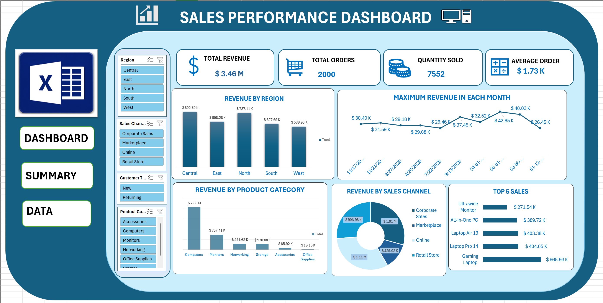
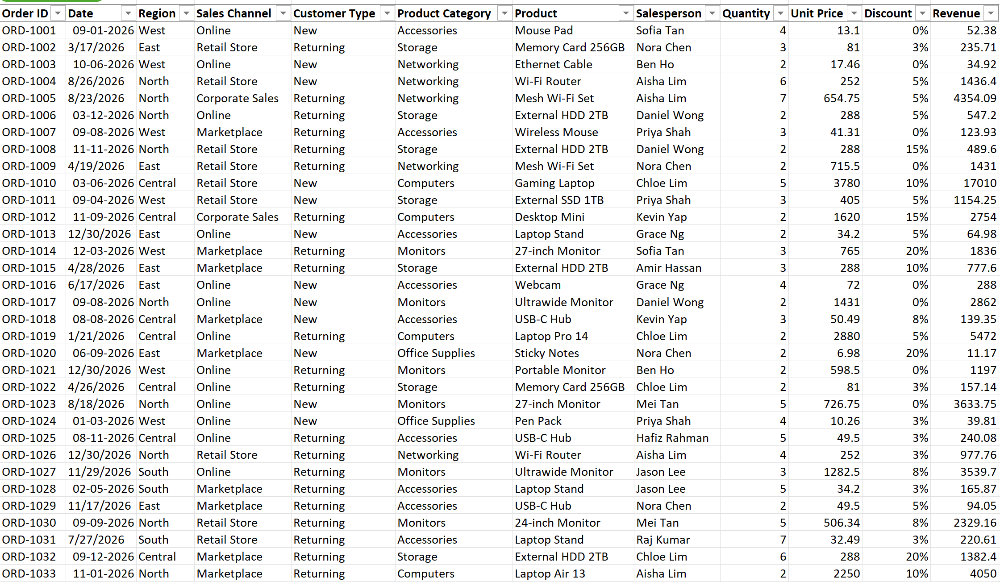

# Sales-Analysis-Dashboard
Interactive Sales Dashboard built using Microsoft Excel, featuring Pivot Tables, Pivot Charts, KPIs, and slicers to analyze sales performance and generate meaningful business insights.

## Project Preview

## Project Overview
This project focuses on developing an interactive Sales Analysis Dashboard using Microsoft Excel to analyze and visualize sales data. It provides insights into sales performance, product categories, revenue trends, and business performance through interactive charts, Pivot Tables, and slicers. The dashboard helps users identify sales patterns, monitor key performance indicators (KPIs), and make data-driven business decisions.

## From Data to Dashboard

Transforming raw sales data into meaningful business insights using Microsoft Excel.
This project demonstrates the complete data analysis process, including data cleaning, data organization, Pivot Tables, KPI calculations, interactive charts, and dashboard creation.
The dashboard provides a clear view of sales performance and helps identify trends, patterns, and key business insights through interactive visualizations.

## Source Data

## Dashboard Features

- **KPI Cards:** Total Revenue, Total Quantity, Average Revenue, and Total Orders.
- **Revenue by Region:** Compare sales performance across different regions.
- **Revenue by Product Category:** Identify the highest-performing product categories.
- **Sales Channel Analysis:** Analyze revenue across different sales channels using a Doughnut Chart.
- **Top 5 Sales:** Highlight the top five sales performances.
- **Monthly Revenue Analysis:** Track maximum revenue generated in each month.
- **Interactive Filters:** Use slicers to filter and explore sales data.
- **Data Visualization:** Present business insights through interactive charts and graphs.

## Files Included

| File | Description |
|---|---|
| DASHBOARD.xlsx | Completed Excel dashboard |
| DASHBOARD.png | Preview of the final dashboard |
| Data.png | Preview of the source data |
| README.md | Project documentation |

## How to Download and Use

1. Download your-dashboard.xlsx.
2. Open the workbook using Microsoft Excel.
3. Navigate to the dashboard worksheet.
4. Use the available filters and slicers to explore the results.

[Download the Excel Dashboard](DASHBOARD.xlsx)

